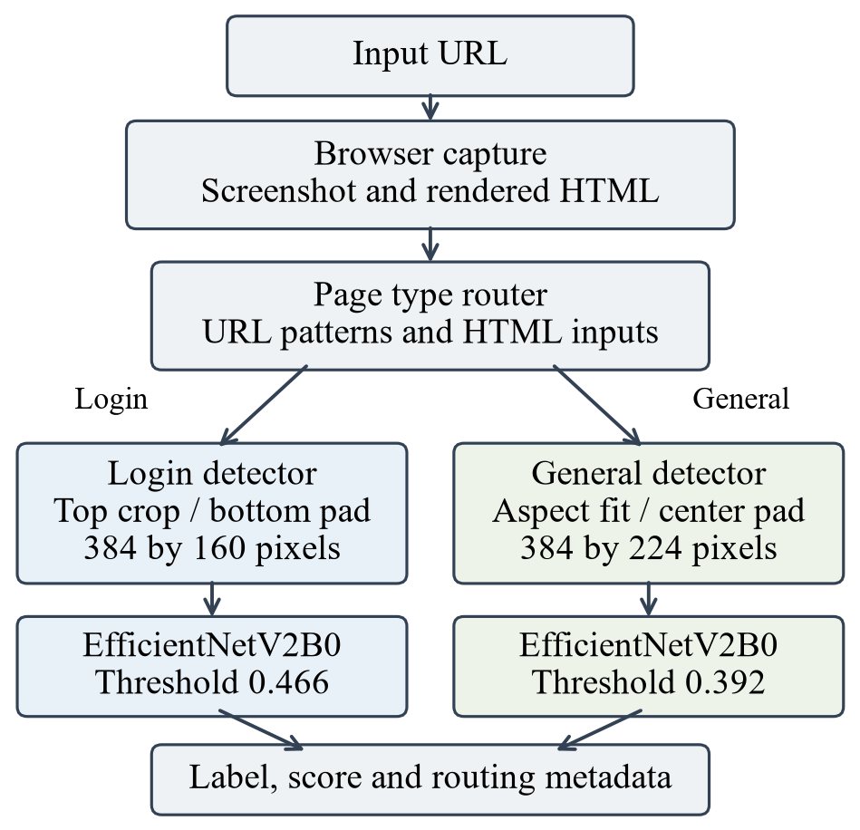
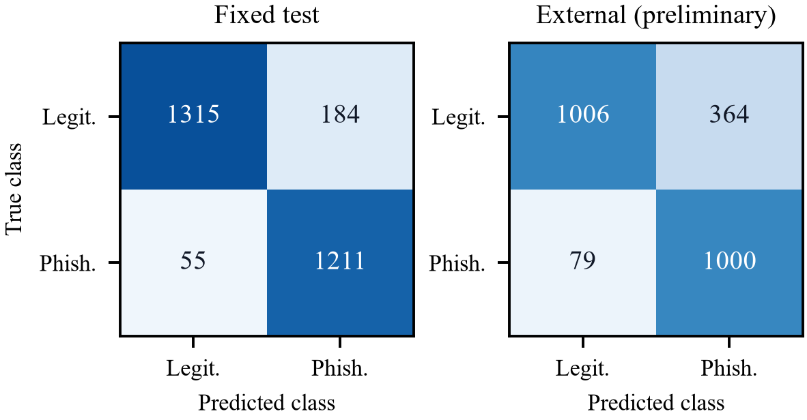

# Page Type Aware Visual Phishing Detection Using EfficientNetV2B0

M.A Oshan Rashmika
Sri Lanka Institute of Information Technology, Sri Lanka
Oshanrashmika180@gmail.com

Abstract—Visual phishing detection analyzes the appearance of webpages, but evaluation can be distorted by screenshot collection artifacts and differences between datasets. This paper presents a page type aware component that routes login pages and general webpages to separate EfficientNetV2B0 classifiers. The models use transfer learning, distinct image preparation pipelines, and validation selected decision thresholds. Saved evaluation artifacts show that the general webpage classifier achieves 91.36 percent accuracy, 95.66 percent phishing recall, and an F1 score of 0.9102 on 2765 fixed test images. A preliminary external evaluation on 2449 internally deduplicated Phish Iris images achieves 81.91 percent accuracy and an F1 score of 0.8187, with cross dataset overlap checking incomplete. The deployed login classifier achieves 81.54 percent diagnostic accuracy on 428 images, whereas a classifier using only original image dimensions achieves 100 percent accuracy on the same split. This finding exposes a strong dataset shortcut and limits claims about learned visual cues. The contribution is an implemented detection component and an evidence based assessment of its performance, checkpoint selection, and remaining validation needs. End to end routing performance and unseen brand generalization remain unestablished.

Keywords—visual phishing detection, EfficientNetV2B0, transfer learning, page type routing, dataset bias, cross dataset evaluation

## Introduction

Phishing webpages can imitate familiar interfaces to persuade visitors to disclose credentials. Screenshot analysis provides a way to study the visual presentation of a page, including forms, text arrangement, colors, and branding. Earlier visual approaches include Phishpedia, which identifies brand impersonation through logo recognition and matching [1]. Visual similarity also creates an evaluation difficulty: a detector may distinguish the collection procedures of two classes instead of identifying evidence of phishing.

Login interfaces and general webpages have different visual structures. A login screenshot often centers on a small credential form, while a general webpage can include navigation, illustrations, and multiple content regions. This motivates investigating separate image preparation and classification paths. However, architectural motivation alone does not establish that routing improves detection. A comparison against a single model on the same routed evaluation set is required to demonstrate that benefit.

This work examines the implemented Micro Visual Cue Component. Its scope is binary screenshot classification, with URL and hypertext markup language (HTML) evidence used to select the classifier. It does not infer a target brand or compare a page domain with an authorized brand domain. The name describes the project component; the current classifiers process whole prepared images and do not explicitly extract a predefined set of micro visual features.

The study has three contributions: an implemented pipeline connecting webpage capture, deterministic page type routing, two transfer learning classifiers, and an application programming interface (API); a reconstruction of training and evaluation protocols from saved manifests and reports; and a diagnostic analysis using simple baselines, preliminary external evaluation, same brand examples, and explanation tools. All numerical results below come from existing artifacts. No new training, threshold tuning, or live URL experiment was performed in preparing this paper.

## Related Work

Phishpedia combines logo detection and brand matching to identify visually impersonated webpages [1]. Its output includes a target brand, and its training approach does not require phishing examples. The present component instead trains binary classifiers on legitimate and phishing screenshots. These approaches address related but distinct decisions; their published metrics cannot be treated as directly comparable without shared data and a common evaluation protocol.

EfficientNetV2 introduces convolutional architectures designed to improve training efficiency and parameter efficiency [2]. This work uses the B0 implementation as an ImageNet initialized feature extractor, followed by partial fine tuning. The implementation choice provides a concrete transfer learning backbone; the project has not established an inference speed or energy advantage over other architectures.

Phish360 provides URL, HTML, and screenshot data for multimodal research [3]. Here, its screenshots support training and evaluating the general detector; the classifier does not jointly fuse those modalities. Phish-Iris supplies screenshots categorized into fourteen phishing brands and an additional legitimate category [4]. This study uses a local cleaned binary mapping of that collection for preliminary external evaluation. Counts reported here describe the local audited copies, rather than assuming that they exactly reproduce every sample in the published releases.

Gradient weighted class activation mapping (Grad-CAM) uses gradients and convolutional activations to produce spatial explanations [5]. The research suite includes Grad-CAM and controlled white masking of specified regions. These tools are used as diagnostic probes of frozen classifiers. They do not replace independent evaluation or establish that a classifier relies on semantically correct features.

## Component Design

### Webpage Capture and Page Type Routing

Fig. 1 summarizes the implementation. The capture routine uses Playwright with Chromium, a 1366 by 768 pixel viewport, a navigation timeout of 30 seconds, and a three second wait after document content loading. It stores the rendered HTML and a viewport screenshot rather than a full page screenshot. This rendering setup can differ from the collection setup used for training, so consistent browser capture is a relevant source of distribution shift.

Fig. 1. Implemented component. Routing chooses one classifier; the two model scores are not fused.

The router selects the login path when it detects a recognized login or sign in URL pattern, or when the HTML contains a form together with password and user identifier inputs. Identifier evidence includes email input types, username or email autocomplete attributes, and relevant input attributes. A visible login navigation link alone does not trigger login routing. Pages without the required evidence use the general webpage path. The returned HIGH or MEDIUM confidence is a rule label, not a learned or calibrated probability.

HTML processing uses regular expressions and approximate visible text extraction, so it is not a full document object model analysis. Inputs need not be associated with the same form in this heuristic. Passwordless authentication, controls inside frames or shadow trees, and pages with incomplete rendering can therefore challenge routing. The available classifier experiments select the model from manifests and do not measure router accuracy.

### Model Specific Image Preparation

For Model 1, the login detector, the image is converted to red green blue (RGB), with exchangeable image file orientation handled. Its width is resized to 384 pixels using Lanczos interpolation while preserving aspect ratio. The upper 160 pixels are retained if the resized height is sufficient; otherwise the image is aligned at the top of a white 384 by 160 canvas. This defines a consistent top viewport, but may remove a form positioned lower on a page.

For Model 2, the general detector, the image is decoded with three channels. The scale is the smaller of 384 divided by original width and 224 divided by original height. Bilinear antialiased resizing preserves aspect ratio, and centered white padding produces a 384 by 224 input. Both paths supply floating point pixels in the range zero to 255 because preprocessing is included inside EfficientNetV2B0. An additional division by 255 is not applied.

### Classifiers and API Integration

Both models end in a sigmoid output representing the phishing class score. Model 1 uses average pooled backbone features, dropout of 0.35, a 128 unit swish dense layer with L2 regularization of 0.00001, dropout of 0.20, and a single output unit. Model 2 uses global average pooling, dropout of 0.30, and a single output unit. The login model has 6083409 parameters in the saved configuration. Model capacity alone is not evidence of effective cue learning.

A page is labeled phishing when its selected score reaches the model threshold: 0.466 for Model 1 and 0.392 for Model 2. FastAPI exposes health and prediction endpoints. Models are loaded during startup, and a lock serializes predictions in the integration implementation. Responses include the label, score, selected model, threshold, and routing metadata. The sigmoid values are reported by the software as probabilities, but no dedicated calibration study is available.

## Experimental Method

### Datasets and Split Construction

Table I lists the sample counts used in the archived experiments. The login data have balanced legitimate and phishing classes in each split. Their recorded seed is 20260826. The split reports show no cross split path or exact hash leakage, but the test set had already been inspected during development. Consequently, subsequent login results are diagnostic and must not be presented as performance on a fresh final test set. Full source attribution and brand coverage of this local login collection remain documentation gaps.

**TABLE I. LOCAL DATASET AND SPLIT COUNTS**

| Collection / split | Legit. | Phish. | Total |
| --- | --- | --- | --- |
| Login train | 996 | 996 | 1992 |
| Login validation | 213 | 213 | 426 |
| Login diagnostic | 214 | 214 | 428 |
| Phish360 train | 2434 | 2434 | 4868 |
| Phish360 validation | 608 | 608 | 1216 |
| Phish360 fixed test | 1499 | 1266 | 2765 |
| Phish-Iris external | 1370 | 1079 | 2449 |

The local Phish360 audit starts from 10734 valid images. Review and exact overlap cleaning exclude 19 training or validation images while preserving all 2765 fixed test images. Among 45 reviewed near duplicate candidate pairs, 17 are confirmed and 28 retained as false matches. Balanced group aware splitting with seed 42 yields 4868 training and 1216 validation images; 1866 surplus legitimate training or validation images are unused. The reports record no remaining exact cross split leakage or confirmed pair leakage. This does not exclude every possible shared template.

The local external Phish-Iris audit finds 2849 valid images and removes 400 exact duplicate copies, leaving 2449 unique images. The original brand folders are mapped to phishing and the other folder to legitimate. Both original source partitions are included because this model was trained on a different collection. However, cross collection near duplicate checking against Phish360 is recorded as incomplete. The archived evaluation therefore remains preliminary, even though internal exact duplicates were removed.

### Training and Threshold Selection

Model 1 uses batch size 16 and Adam optimization. A frozen backbone phase permits up to 15 epochs at learning rate 0.001. Partial fine tuning permits up to 20 epochs at 0.00001, requesting the last 40 backbone layers while freezing batch normalization. Training only augmentation applies translation of 0.02, zoom between minus 0.03 and 0.03, and contrast of 0.08, with no horizontal flipping or rotation. Checkpoint selection uses validation average precision; the decision threshold is selected using validation Matthews correlation coefficient.

A continuation experiment subsequently runs for 12 of a permitted 15 epochs at learning rate 0.0000025. It does not meet the recorded minimum validation average precision gain of 0.001, and its validation Matthews correlation coefficient decreases slightly. The selection report retains the earlier checkpoint with hash prefix 6be68e84. The component configuration nevertheless deploys the continuation checkpoint with prefix d4d112fc. This is a recorded mismatch between model selection and deployment. Results for these two checkpoints are reported separately, without inferring that continuation improved generalization.

Model 2 uses batch size 16, a frozen backbone phase permitting 20 epochs at 0.001, and partial fine tuning permitting 15 epochs at 0.00001. Its augmentation includes translation of 0.02, zoom between minus 0.04 and 0.04, and contrast of 0.08. Validation precision recall area is monitored during training. Threshold 0.392 is chosen by maximum validation F1 and locked for the fixed test evaluation. The archived report states that the threshold was not changed after test inspection.

### Metrics and Diagnostic Controls

Phishing is the positive class. We report accuracy, phishing precision, recall, F1, and false positive rate (FPR). Recall equals true positives divided by all phishing images; FPR equals false positives divided by all legitimate images. Precision uses all positive predictions as its denominator, and F1 is the harmonic mean of precision and recall. Counts are included so that class imbalance and operational errors are visible.

The login comparison adds two logistic controls fitted on the same training membership: a color and spatial layout representation using an 8 by 4 grid of RGB means plus eight bin channel histograms, and original width, height, and aspect ratio features. Standardization is fitted on training data only. Logistic thresholds use validation F1, whereas the convolutional neural network (CNN) uses its locked threshold. The controls are diagnostic and differ from CNN augmentation and model selection; they are not an exhaustive comparison of competing detectors.

A twenty image same brand set contains four legitimate and sixteen phishing examples from Facebook, LinkedIn, Microsoft, and PayPal. Each brand has one legitimate and four phishing screenshots. Labels, canonical brands, and provenance require review. A saved audit against 2418 training and validation images reports six unresolved near duplicate candidates, so these examples cannot support an independent generalization claim. Controlled masking additionally probes two selected phishing images using equal area control regions on exact prepared tensors.

## Results and Analysis

### General Webpage Detection

At the locked threshold, Model 2 correctly detects 1211 of 1266 phishing test images, misses 55, and falsely flags 184 of 1499 legitimate images. Its fixed test accuracy is 91.36 percent, recall is 95.66 percent, precision is 86.81 percent, and F1 is 0.9102. Receiver operating characteristic area under the curve is 0.9726. Table II reports the principal model results, and Fig. 2 shows the general detector confusion counts.

**TABLE II. ARCHIVED CLASSIFIER RESULTS**

| Model / evidence | Acc. % | Rec. % | FPR % | F1 |
| --- | --- | --- | --- | --- |
| M2 fixed test | 91.36 | 95.66 | 12.27 | 0.9102 |
| M2 external* | 81.91 | 92.68 | 26.57 | 0.8187 |
| M1 deployed diagnostic | 81.54 | 77.10 | 14.02 | 0.8068 |
| M1 selected diagnostic | 81.07 | 75.70 | 13.55 | 0.8000 |

*Preliminary external evidence; cross dataset overlap checks are incomplete. Login rows use different checkpoints on an already inspected diagnostic split. These rows are not a common benchmark comparison.

Fig. 2. Model 2 confusion counts at threshold 0.392. External data are internally deduplicated but cross dataset independence is unverified.

On the preliminary external data, Model 2 detects 1000 of 1079 phishing images and falsely flags 364 of 1370 legitimate images. Accuracy declines to 81.91 percent, precision to 73.31 percent, and F1 to 0.8187, while recall remains 92.68 percent. The accuracy decline is 9.45 percentage points and FPR increases by 14.29 percentage points. This pattern is consistent with sensitivity to dataset shift, but incomplete overlap checking and label provenance limit causal attribution and independence claims.

The test archive also includes a default threshold of 0.5 as a reference. It reduces fixed test FPR to 9.01 percent while lowering recall to 93.36 percent. Its higher test F1 does not authorize replacing the validation selected threshold after observing the test results. A deployment threshold should be chosen on separate validation data using the intended costs of missed phishing pages and false alarms, followed by a new reserved evaluation.

### Login Checkpoints and Dataset Shortcuts

The deployed continuation checkpoint produces 184 true negatives, 30 false positives, 49 false negatives, and 165 true positives on the 428 image diagnostic set. Its accuracy is 81.54 percent and F1 is 0.8068. The earlier selected checkpoint produces 185 true negatives, 29 false positives, 52 false negatives, and 162 true positives, with 81.07 percent accuracy. The modest numerical differences do not establish a reliable improvement, particularly because the split is already inspected and the continuation checkpoint failed its validation selection gates.

Table III gives the diagnostic control comparison for the deployed checkpoint. The color and layout control reaches 66.36 percent accuracy and 49.53 percent FPR. More significantly, original dimensions alone produce perfect classification: 214 true negatives and 214 true positives, with no errors. This establishes that original image geometry is highly predictive of class in these splits. It does not establish that the CNN directly accesses original dimensions, because its inputs are prepared to fixed sizes. Resizing, cropping, padding, and source specific visual artifacts nevertheless remain plausible shortcut channels requiring controlled testing.

**TABLE III. LOGIN DIAGNOSTIC CONTROLS**

| Method | Acc. % | Rec. % | FPR % | F1 |
| --- | --- | --- | --- | --- |
| Color / layout logistic | 66.36 | 82.24 | 49.53 | 0.7097 |
| Dimensions logistic | 100.00 | 100.00 | 0.00 | 1.0000 |
| Deployed login CNN | 81.54 | 77.10 | 14.02 | 0.8068 |

The dimensions result is an adverse validity finding rather than a deployment recommendation. A meaningful next experiment would collect both classes under matched browser, viewport, and rendering conditions, preserve source and template groups when splitting, and evaluate newly trained checkpoints on reserved data. Reusing these checkpoints with a newly proposed split would not make their original training brand disjoint.

### Same Brand and Explanation Diagnostics

The exploratory login set yields four true negatives, zero false positives, seven false negatives, and nine true positives. Accuracy is 65.00 percent, phishing recall is 56.25 percent, and F1 is 0.7200. Brand recalls are 75 percent for Facebook, 25 percent for LinkedIn, 50 percent for Microsoft, and 75 percent for PayPal. With only one legitimate screenshot per brand, zero observed false positives is weak evidence about the false alarm rate. The unresolved overlap candidates further restrict interpretation.

The suite exports class heatmaps, prepared inputs, source images, scores, and checkpoint metadata. Its archived verification reports exact forward score agreement for the explanation graph and checks 44 class maps. This supports numerical consistency of the explanation implementation, not semantic correctness. Heatmaps are normalized per image, and their intensity should not be compared across examples.

Masking the selected Model 2 form lowers its score from 0.9682 to 0.9461, while an equal area control lowers it to 0.9587. Masking its branding region instead increases the score to 0.9833; the branding control produces 0.9690. For the selected Model 1 image, form masking increases the score from 0.9646 to 0.9711, and both controls also increase it. All seven perturbations retain the phishing label. These two sample probes show heterogeneous responses and do not establish brand independence, form dependence, or an explanation performance rate.

## Limitations and Future Evaluation

The strongest available result concerns a standalone general classifier on the preserved local Phish360 test split. It does not measure the complete capture and routing pipeline. End to end validation needs labeled page types and phishing labels on the same reserved URL collection, including capture failures, rendering variability, and incorrect routing. A single detector and the routed system should then be compared on identical cases. No measured latency, throughput, or calibrated risk estimates are supplied here.

For the login detector, dimensions predictability, incomplete collection provenance, and repeated diagnostic test use substantially limit scientific interpretation. For external evaluation, internal deduplication is insufficient until cross dataset exact and near duplicate checks are complete. A complete reviewed training brand inventory is also unavailable, so no unseen brand evaluation is established. Existing brand names or heatmaps cannot substitute for a held out brand protocol.

Future work should reconcile the deployed login checkpoint with the recorded selection decision, document dataset licensing and collection sources, resolve overlap candidates, and create matched acquisition data. New training experiments should reserve domain, template, brand, and preferably time based holdouts before model selection. Evaluation should retain counts, per brand errors, uncertainty estimates appropriate to correlated templates, and checkpoint hashes. Region studies need multiple brands, both correct predictions and errors, and semantically reviewed controls fixed before scores are examined.

## Conclusion

The Micro Visual Cue Component implements page type routing and two EfficientNetV2B0 screenshot classifiers with distinct preparation pipelines and locked decision thresholds. Archived general detector results show high phishing recall on the fixed local test set, alongside a substantial false positive increase on preliminary external data. The login dimensions baseline reveals a major dataset shortcut, and the deployed checkpoint differs from the checkpoint retained by validation selection. These findings support an implementation and diagnostic study while identifying the conditions needed for stronger claims: matched screenshot acquisition, verified data independence, consistent checkpoint selection, and reserved end to end evaluation.

## References

[1] Y. Lin et al., “Phishpedia: A hybrid deep learning based approach to visually identify phishing webpages,” in Proc. 30th USENIX Security Symposium, 2021, pp. 3793–3810. https://www.usenix.org/conference/usenixsecurity21/presentation/lin

[2] M. Tan and Q. Le, “EfficientNetV2: Smaller models and faster training,” in Proc. 38th International Conference on Machine Learning, PMLR, vol. 139, 2021, pp. 10096–10106. https://proceedings.mlr.press/v139/tan21a.html

[3] A. H. A. Almakhamreh and A. S. Bozkir, “CrossPhire: Benefiting multimodality for robust phishing web page identification,” Applied Sciences, vol. 16, no. 2, article 751, 2026, doi: 10.3390/app16020751. Dataset: https://web.cs.hacettepe.edu.tr/~selman/phish360-dataset/

[4] A. S. Bozkir and F. C. Dalgic, “Phish-Iris dataset: A small scale multi-class phishing web page screenshots dataset,” Mendeley Data, version 1, 2018, doi: 10.17632/tk4fkswtj5.1. https://data.mendeley.com/datasets/tk4fkswtj5/1

[5] R. R. Selvaraju, M. Cogswell, A. Das, R. Vedantam, D. Parikh, and D. Batra, “Grad-CAM: Visual explanations from deep networks via gradient-based localization,” in Proc. IEEE International Conference on Computer Vision, 2017, pp. 618–626, doi: 10.1109/ICCV.2017.74. https://arxiv.org/abs/1610.02391
